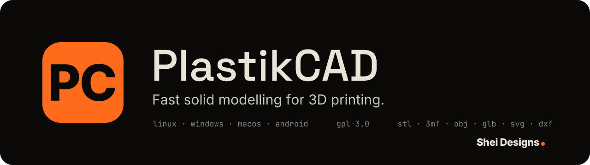

<h1 align="center">
  
</h1>

Fast solid modeling for 3D printing: a desktop app for bashing out a part from
a few simple shapes.
Drop boxes, cylinders and wedges on the plate, add a gear, a pulley or a
threaded rod made to your numbers, turn some of it into holes, group, and
export a file for your slicer. Every design keeps its own version history.

Runs locally on Linux, Windows and macOS; nothing leaves your machine. Free
software under the GPL-3.0.

BashCAD supersedes [Gearwright](https://github.com/AOShei/gearwright): every
part type and parameter it had is in here, as objects you can combine with
everything else.

## How it works

It is the Tinkercad way of modeling, without the cloud and without the clutter:

- **Shapes** – box and cylinder (both with optional rounded edges), sphere,
  cone, pyramid, wedge, roof, round roof, polygon prism, torus and dome. Click
  one, then click on the plate (or on top of another object) to put it down.
- **Parts** – the Gear, Pulley and Screw tiles place a parametric part. The
  panel shows what it is for, a picture menu of the kinds in that family, the
  parameters in tabs (gear, tooth form, hub, bore; thread, head; and so on),
  the dimensions that follow from them (pitch diameter, outside diameter,
  center distance...). A part is just an object: group it, cut it, scale it,
  version it. See
  [Parts](#parts) for the list.
- **Text** – lettering in four print-friendly fonts (sans, slab serif,
  monospace, stencil), on one line or several. Put it on a face and group it
  to emboss; make it a hole and sink it in a little (Ctrl+Down) to engrave.
- **Fillet** – an edge cutter that comes in as a hole. Line it up with an edge
  (select both, then Align), group, and the edge is rounded; with one step it
  cuts a straight chamfer instead.
- **Solid or hole** – any object can add material or cut it away.
- **Group** – merges the selected solids and cuts the holes out of them. Groups
  can be grouped again, turned into holes themselves, and taken apart at any
  time: nothing is ever baked in. Grouping only holes gives one hole: a
  connector cut-out with its screw holes becomes a single template to drop
  into any panel.
- **Array** – copies of the selection in a row, a grid or a stack at a set
  spacing, or around a ring. Select a hole together with the plate it goes in and
  *Fit* spreads the copies over the plate, a set distance in from its edges:
  four corner holes in one go. For a ring, put the hole where the middle of
  the bolt circle goes and type its radius or diameter; or leave the hole where
  it is and ring it around the middle of the plate, or around any point. The
  pattern shows live while the numbers are typed.
- **Structure** – a grouped object shows its history as a tree in the panel:
  primitives on the left, each grouping a node further right, branches merging
  where things were grouped together. Hover a node to see that part on the
  plate; pick one and *Edit here* takes the groupings apart down to it, so the
  part can be changed, and *Done* puts them back together in the same order.
- **Handles** – drag an object to move it, the corner and edge grips to size
  it (the top and bottom grips pull the height either way), the arrow to lift
  it, the colored arcs to turn it. Click a grip instead of dragging it and a
  box appears on that edge to type the value. Or type exact numbers in the
  panel on the right.
- **Import** – STL, OBJ and 3MF meshes, and SVG drawings (extruded into a
  plate), which then behave like any other object. Drop files on the window.

## Parts

| Gears | Pulleys & sprockets | Screws & threads | Rails & frames | Pipes & ducts | Dev boards | Panel cutouts | Motor mounts |
| --- | --- | --- | --- | --- | --- | --- | --- |
| Spur gear | GT2 timing pulley (2 / 3 / 5 mm) | Metric bolt / threaded rod (M3–M20) | Aluminum rail: 20, 30 and 40 mm series, V-slot or T-slot, one to four cells in one or two rows (2020, 2040, 4040, 3030, 3060, 6060, 4080...) | Straight pipe or duct | Raspberry Pi 5, 4, 3, Zero 2 W, Pico | Fan: 25–140 mm, round opening, guard rings or holes only | Stepper: NEMA 8, 11, 14, 17, 23 and the 28BYJ-48 |
| Helical gear | HTD timing pulley (3M / 5M / 8M) | Metric nut | | Elbow (any angle and bend radius, legs either side) | Arduino Uno R3/R4, Mega 2560, Nano | Panel connector: Neutrik D-series, IEC C14 / C13 / C8, D-sub 9 / 15 / 25, XT60, with their screw holes | Gearmotor: N20, TT, 25 mm (JGA25), 37 mm (JGB37) |
| Herringbone gear | T-series timing pulley (T2.5 / T5 / T10) | Trapezoidal lead screw (multi-start) | | Reducer (in line or eccentric) | ESP32-DevKitC V4, DevKit V1, NodeMCU-32S | | Servo: SG90, MG996R |
| Internal ring gear | MXL / XL timing pulley | Lead screw nut (flanged) | | Tee / wye (branch at any angle) | | | DC motor: 775, 130 |
| Gear rack (straight, helical, herringbone) | Chain sprocket (#25–#41, 05B–08B, bicycle) | | | | | | |
| Bevel gear (90° shafts) | | | | | | | |
| Worm | | | | | | | |

Rotating parts share the same options for the shaft: round, D-shaft, hex or
keyed bore with a fit clearance, plus an optional hub with set-screw holes.
Pipes and ducts are round or rectangular (with rounded corners), hollow with a
wall or solid, and the bends are true arcs, the tapers true frustums; a solid
elbow makes a good hole to cut a curved channel with.
A dev board part knows the board's outline, mounting holes and sockets from
its maker's drawing and makes one of five things from them: standoffs at the
holes, drilled for the screw to cut its thread, for a clearance fit or for a
heat-set insert, on an optional base plate; the holes alone, as pins to group
with a floor or lid as a hole; a blank the shape of the board, to check fit
or, grown by a gap, to pocket a floor; the board with its connectors in place,
each reaching out past the edge, to design a case round and, made a hole, to
cut the wall openings exactly where the plugs go; or corner stops, which hold
the ESP32 dev kits and anything else without holes. The ESP32 figures are the least certain: only
Espressif's own DevKitC has a published drawing, so the part says so.
A motor mount knows the motor's mounting face from its maker's drawing: the
bolt pattern, the pilot boss or the body that drops through, and the shaft.
It makes a plate with the holes and the bore, the holes alone as a cutter, the
motor itself as a body to design round (or, made a hole, to pocket for), or an
L-bracket standing the plate on a slotted, gusseted foot.
A panel cutout is an opening a wall needs that is worth looking up rather
than drawing: a fan's opening with its screw pattern, or a connector's cutout
with its screw holes as its maker draws it. Each is grown by a clearance and
comes lying through a wall across Y, a case front; turn it to a side or the
floor, make it a hole and group it with the wall.
The rail is there to design around: make it a hole and group it with a block
to get a bracket that fits the real thing. It comes in as a 20 mm stub; its
height is its length, so pull the top grip or type the H size to make it as
long as you need.
Only the kind and its parameters are stored in the design; the geometry is
made from them.

## Versions

A design remembers where it has been.

- **Save version** keeps the design as it is now, with a name and a thumbnail.
- Click a version to look at it, **restore** it to carry on from there (the
  state you left is one undo away), or export it directly.
- Saving after restoring an old version starts a branch: every version records
  which one it was made from.
- Versions live inside the design file, so they travel with it. No account, no
  server, no folder of `bracket-v3-final-2.stl`.

A `.bashcad` file is plain JSON, written to diff well: keys in a fixed order,
one property per line, vectors on a single line. If you keep designs in git,
a change to one object shows up as a change to a few lines.

```json
{
  "id": "k5u5gu2a",
  "type": "shape",
  "name": "Box",
  "shape": "box",
  "pos": [0,0,10],
  "rot": [0,0,0],
  "size": [20,20,20],
  "color": "#8fa3bf"
}
```

The app also keeps a copy of the open design between sessions, so an unsaved
design is still there after a restart.

## Mouse and keyboard

| | |
| --- | --- |
| Orbit / pan / zoom | Right drag / middle drag (or Shift + right drag) / wheel |
| Select | Click; Shift-click adds; drag on the plate for a box selection |
| Move | Drag (Shift keeps to one axis); arrow keys nudge by the snap step, Shift ×10 |
| Raise or lower | Arrow handle; Ctrl+Up / Ctrl+Down |
| Resize | Corner and edge grips; the top grip pulls the height up, the bottom grip pulls it down; Shift scales evenly |
| Type a value | Click any grip instead of dragging it, type the value (two for a corner grip, e.g. `20 x 15`), Enter |
| Turn | Colored arcs, in 15° steps; Shift 45°, Alt 1° |
| Duplicate / copy / paste | Ctrl+D / Ctrl+C / Ctrl+V |
| Group / ungroup | Ctrl+G / Ctrl+Shift+G |
| Solid / hole | S / H |
| Drop onto the plate | D |
| Flip (mirror) on an axis | X / Y / Z |
| Turn 90° about an axis | Shift+X / Shift+Y / Shift+Z; add Alt to turn the other way |
| Align | L shows anchor dots on the selection: hover one to preview, click to apply; click one of the objects to make it the anchor, Esc to finish |
| Align by key | Alt+← / → / ↓ / ↑ (left / right / front / back), Alt+PgDn / PgUp (bottom / top); add Shift to center on that axis; Alt+C centers on X and Y |
| Fit to view | F |
| Undo / redo | Ctrl+Z / Ctrl+Y |
| Save / save as / open / new | Ctrl+S / Ctrl+Shift+S / Ctrl+O / Ctrl+N |
| Import | Ctrl+I |
| Save a version | Ctrl+Shift+V |

## Export formats

| Format | Use |
| --- | --- |
| STL | 3D mesh for any slicer |
| 3MF | 3D mesh with units, preferred by modern slicers |
| OBJ | 3D mesh for modeling tools |
| SVG | Outline of the design seen from above, for laser cutters and vector editors |
| DXF | The same outline, to extrude in CAD or cut on a laser / CNC |

The button reads *Export selection* when something is selected and exports just
that; otherwise *Export* merges everything visible that is not a hole into one
watertight mesh (after asking, when there are several objects). Units are
millimeters, Z is up.

The file is made at a finer detail than the screen: round shapes, gear teeth
and threads get twice the facets they are drawn with, so prints come out
smooth while the editor stays quick. A cylinder set to a handful of sides is
left alone, since that is its shape.

## Import notes

- **STL / OBJ** carry no units; coordinates are taken as millimeters.
- A mesh that is not watertight can be placed, scaled and exported as it is,
  but cannot be grouped: there is no telling its inside from its outside.
- **3MF**: all objects on the build plate come in as one mesh; colors and
  slicer settings are ignored.
- **SVG**: every closed outline is filled and extruded, whatever its stroke or
  fill, so laser-cutter drawings work (including a gear profile exported from
  BashCAD as SVG). Convert text to paths first; `<use>`, images and CSS
  classes are not read.

## How accurate are the parts?

- **Involute gears** are generated the way a real gear is cut: a rack cutter
  rolls around the blank. Flanks are true involutes, root fillets are the
  trochoids the cutter tip would leave, and small pinions get the same undercut
  a hobbed gear has (with a warning and the profile shift that removes it).
  Helical gears take the module and pressure angle in the normal plane.
- **Bevel gears** use Tredgold's approximation (the usual construction for cut
  and printed straight bevels), not a spherical involute.
- **Timing pulleys** use the standard pitch and outside diameters. The groove
  shapes are parametric fits to the belt standards rather than the
  manufacturers' multi-arc drawings, with a clearance setting to tune the fit
  on your printer.
- **Sprockets** use the common arc-based drafting construction, not the full
  ANSI B29.1 tooth form.
- **Threads** follow the ISO metric and ISO trapezoidal basic profiles, with a
  clearance setting for printing.
- **Extrusions** follow one maker's section drawing per size, the others
  being within a few tenths of it: OpenBuilds V-Slot for 20 mm, Misumi HFS6
  for 30 mm and HFS8 for 40 mm. Lip thickness, slot opening, channel width,
  the 45° taper down to the square core, bore, web thickness, outer corner
  radius and the corner holes (30) and hollows (40) are all read off the
  drawings; the T-slot is the same section with square lips, the V-slot the
  same with 45° lip tips. Where two cells meet, the cores and webs frame the
  hollow of the real 2040 with its short neck to the skin; where four meet,
  the middle is open with the cores' corners rounded, and in a two-row bar of
  three or four cells the inner cells get walls across it. The sectional areas
  come out within a few percent of the catalog figures (V-Slot 2020 about
  166 mm², HFS6-3030 333 mm², HFS8-4040 640 mm²). Left out are the small inner
  fillets and the scalloped bores, so check against the rail you have before
  relying on a tight fit.

Dimension tables (chain sizes, hex sizes, belt pitch-line offsets) were entered
by hand. Check critical dimensions against a datasheet before relying on them.

## Fonts

Text is set in fonts that ship with the app, so a design looks the same on
every machine: [Inter](https://rsms.me/inter/) (sans),
[Roboto Slab](https://github.com/googlefonts/robotoslab) (slab serif),
[JetBrains Mono](https://www.jetbrains.com/lp/mono/) (monospace) and
[Allerta Stencil](https://fonts.google.com/specimen/Allerta+Stencil), all in
bold or heavy cuts with Latin and extended Latin characters. Inter, JetBrains
Mono and Allerta Stencil are under the SIL Open Font License 1.1; Roboto Slab
is under the Apache License 2.0; the license texts are in
`public/font-licenses/` and ship with the app. A design stores only the
words, not their outlines.

## Development

Requirements: [Node.js](https://nodejs.org) 22+, [pnpm](https://pnpm.io),
[Rust](https://rustup.rs), and the
[Tauri system dependencies](https://tauri.app/start/prerequisites/) for your
platform.

```sh
pnpm install
pnpm tauri dev      # run the desktop app with hot reload
pnpm dev            # or just the UI, in a browser at http://localhost:1420
pnpm test           # model, geometry, part and file-format tests
pnpm typecheck
pnpm tauri build    # build installers into src-tauri/target/release/bundle
```

The app icon is drawn in `src-tauri/app-icon.svg` (Windows and Linux) and
`src-tauri/app-icon-macos.svg` (the same mark with the margin macOS expects).
After editing them, regenerate the bitmaps with `pnpm tauri icon` — see
[the Tauri docs](https://tauri.app/develop/icons/).

Pushing a `v*` tag runs `.github/workflows/release.yml`, which builds installers
for all three platforms and attaches them to a draft GitHub release.

### How it is put together

```
src/
  model/              the design: nodes, transforms, grouping, the file format
  geometry/
    shapes.ts         the basic shapes: their parameters and how each is built
    kernel.ts         turns nodes into meshes (Manifold kernel), with caching
  worker/             runs the kernel off the UI thread
  state/              the editor: selection, undo, versions, files, preferences
  viewer/             three.js view: drawing, picking, handles
  parts/              the gear, pulley, sprocket and thread generators
  io/                 STL, 3MF, OBJ, SVG, DXF writers; STL, OBJ, 3MF, SVG readers
  text/               fonts, and laying words out as outlines
  ui/                 React components
  platform.ts         desktop app or plain browser: dialogs, files, drops
src-tauri/            native window, file dialogs, reading and writing files (Rust)
```

A design is a flat list of nodes: shapes, parts, text, imports, and groups of
nodes. A node has a position, a rotation and a size, plus what defines its
form (a shape's parameters, a part's kind and parameters, the words of a
text), and nothing else is stored: no meshes, no history of operations. Solids
are computed from that description by
[Manifold](https://github.com/elalish/manifold) (WebAssembly), which guarantees
watertight results from every union and cut.

What keeps it fast: the geometry of a node is cached under a key that leaves
out where the node is, how it is turned and (for most shapes) how big it is.
Moving, turning and resizing therefore only change a matrix on the graphics
card; the kernel runs when a shape's form changes or a group is made, and then
only for that node. Undo, redo and switching versions reuse the same cache.

### Adding a shape

1. Add its kind to `ShapeKind` in `src/model/types.ts`.
2. Describe it in `SHAPES` in `src/geometry/shapes.ts` (name, default size,
   parameters) and build it in `buildShape`, centered on the origin and filling
   its bounding box.
3. Draw its catalog picture in `src/ui/thumbnails.tsx`.

The palette, inspector, file format and export pick it up from there.

### Adding a part

1. Write a `GeneratorDef` in `src/parts/generators/` — its parameter groups
   (each group becomes a tab) and a `build(params, quality)` function returning
   a `Solid` description, an optional 2D `outline` (which also draws its
   picture in the kind picker), and `info` rows for the dimensions tab.
2. Add it to the list in `src/parts/generators/index.ts`. Parts with no
   outline get a glyph in `src/ui/partThumbnails.tsx`.

Generators are plain functions from parameters to a shape description; they
never touch the mesh kernel, which keeps them easy to test.

## Roadmap

- Work plane on any face, ruler and snapping to other objects.
- Text on curved surfaces; more scripts and fonts.
- More parts: throated worm wheel, planetary set helper, V-belt pulleys,
  imperial threads.
- Assembly preview of meshing gears.
- STEP export. Shapes and parts are already described as profiles and
  operations rather than triangles, so a B-rep backend can evaluate the same
  descriptions.

## License

GPL-3.0-or-later. See [LICENSE](LICENSE).
